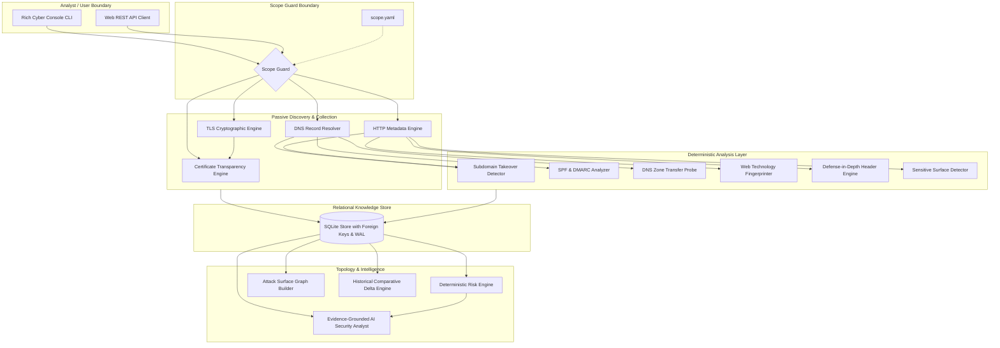

# System Architecture Specification

## 1. System Topology & Dataflow

---

## 2. Component Specifications

### 2.1 Scope Guard (`app/scope_guard.py`)
- **Input:** Target hostname candidate, `ScopeConfig` model.
- **Output:** `(allowed: bool, reason: str)`.
- **Policy:** Wildcards must be explicitly declared as `*.domain.tld`. Any candidate matching an exclusion pattern is immediately rejected and recorded in `audit_events`.

### 2.2 Passive Discovery Engine (`app/pipeline.py`)
- **Input:** Authorized root domain.
- **Output:** Deduplicated set of in-scope candidate hostnames.
- **Source:** Certificate Transparency logs via `https://crt.sh/`.
- **Secondary Source:** Subject Alternative Names (SANs) parsed during TLS inspection of discovered assets.

### 2.3 DNS Security Engine (`app/dns_engine.py`)
- **Input:** Candidate hostname.
- **Output:** `HostDNSProfile` containing `A`, `AAAA`, `CNAME`, `MX`, `TXT`, `NS`, `SOA`, SPF, and DMARC records.
- **Security Probes:**
  - AXFR Zone Transfer misconfiguration probe with 2.0s hard ceiling.
  - SPF evaluation (checks for permissive `+all` and neutral `?all`).
  - DMARC evaluation (checks for absent records and `p=none` policies).

### 2.4 Cryptographic Posture Engine (`app/tls_engine.py`)
- **Input:** Hostname, port 443.
- **Output:** `TLSProfile` containing issuer, subject, SAN list, validity start/end, remaining days, self-signed status, and negotiated TLS protocol version.
- **Heuristics:** Identifies expired certs, near-expiry certs ($\le 14$ days), self-signed certificates, and deprecated protocols (TLS 1.0, TLS 1.1).

### 2.5 Subdomain Takeover Engine (`app/takeover_signatures.py`)
- **Input:** CNAME record, HTTP response body, NXDOMAIN flag.
- **Output:** Confidence, severity, and remediation guidance across 20+ SaaS providers (AWS S3, GitHub Pages, Heroku, Azure, Shopify, Surge, Fastly, Netlify, Fly.io, etc.).

### 2.6 Technology Fingerprinter (`app/fingerprint.py`)
- **Input:** HTTP response headers, cookies, and initial 64KB HTML preview.
- **Output:** Identified technologies with category and version numbers.
- **Signatures:** 50+ patterns covering web servers, fullstack frameworks, client-side libraries, and sensitive surfaces (Swagger UI, Prometheus, Grafana, admin consoles).

### 2.7 Security Posture Analysis (`app/analysis.py`)
- **Input:** Hostname, HTTP status, scheme, and headers.
- **Output:** List of deterministic findings mapped to MITRE ATT&CK and CWE standards.
- **Rules:** Evaluates HSTS quality, CSP directives, X-Frame-Options framing defenses, X-Content-Type nosniff enforcement, Referrer policies, server banner leakage, and staging/development perimeter exposure.

### 2.8 Deterministic Scoring Engine (`app/scoring.py`)
- **Input:** Stored findings and asset environment classification.
- **Output:** Normalized score $R \in [0, 100]$, band (`critical`, `high`, `medium`, `low`), and multidimensional breakdown.

### 2.9 Attack Surface Graph & Comparative Diff (`app/graph.py`, `app/diff.py`)
- **Graph:** Constructs topology linking Domain $\to$ Subdomains $\to$ IPs $\to$ Technologies $\to$ Findings.
- **Diff:** Computes deltas between two scans to identify shadow IT additions, decommissioned hosts, and security regressions.

### 2.10 Grounded AI Security Analyst (`app/ai.py`)
- **Input:** Structured evidence tuples and user security inquiries.
- **Output:** Evidence-backed analysis citing specific asset hostnames, risk scores, and remediation priorities. Prohibits hallucination or score alteration.
