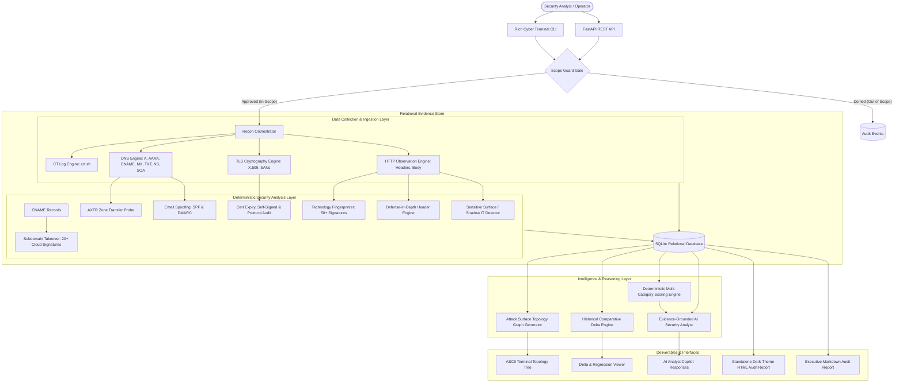
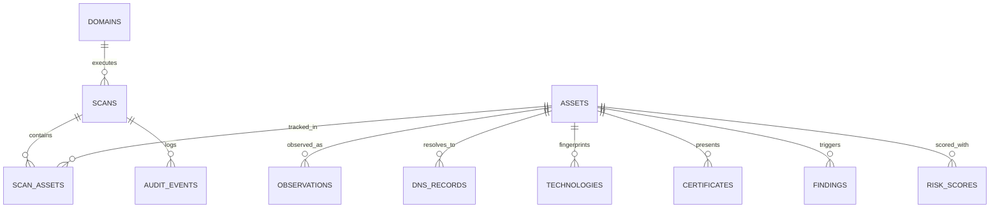

# Perimetryx System Specification

**Version:** 2.0.0  
**Classification:** Technical Architecture & System Specification  
**Domain:** External Attack Surface Management (EASM), Threat Intelligence & Automated Security Analysis  
**Framework Mappings:** MITRE ATT&CK for Enterprise, Common Weakness Enumeration (CWE), CVSS v3.1  

---

## 1. System Overview & Problem Statement

### 1.1 Executive Summary
**Perimetryx** is an authorized external attack surface intelligence and automated threat assessment platform. It transforms a single root domain into a continuously refreshable, evidence-grounded topological map of all externally reachable assets, accompanied by deterministic risk scoring and an AI security analyst layer constrained strictly to verifiable evidence.

Traditional reconnaissance tools (e.g. `subfinder`, `amass`, `httpx`, `nuclei`) execute isolated stages of discovery, DNS resolution, or vulnerability scanning, but offload correlation, threat categorization, false-positive elimination, and impact explanation to human operators. Generic attempts to summarize raw terminal output with large language models (LLMs) introduce critical failure modes: hallucinated vulnerabilities, ungrounded risk metrics, and non-reproducible verdicts.

Perimetryx eliminates these failure modes by enforcing a **hybrid deterministic architecture**:
1. **Scope Guard**: Mandatory authorization boundary before any packet is transmitted.
2. **Multi-Vector Passive Reconnaissance**: CT logs, DNS hierarchy, TLS inspection, and safe HTTP probing.
3. **Deterministic Security Engines**: Subdomain takeover detection, email spoofing posture (SPF/DMARC), DNS zone transfer (AXFR), cryptographic expiration/cipher auditing, web technology fingerprinting, and security header compliance.
4. **Normalized Relational Knowledge Graph**: Every finding links to an asset, observation, and raw network evidence.
5. **Grounded AI Security Analyst**: Analyzes the evidence graph via constrained tool interfaces to explain threat vectors and remediation steps without ever manufacturing scores or hallucinating findings.

---

## 2. High-Level System Architecture



---

## 3. Data Model & Database Schema

The persistence layer is implemented in SQLite with Foreign Keys enforced, WAL mode enabled, and structured schemas representing the entire attack surface entity relationship:

### 3.1 Entity Relationship Diagram



### 3.2 Relational Tables Description

| Table Name | Primary Key | Key Columns | Purpose |
|---|---|---|---|
| `domains` | `id` | `root_domain`, `scope_json`, `created_at` | Tracks authorized organizational root domains and scope policies. |
| `scans` | `id` | `domain_id`, `status`, `dry_run`, `started_at`, `completed_at`, `stats_json` | Lifecycle state of each reconnaissance sweep. |
| `assets` | `id` | `domain_id`, `hostname`, `source`, `environment`, `first_seen_scan_id`, `last_seen_scan_id` | Unique subdomains and targets discovered. |
| `scan_assets` | `(scan_id, asset_id)` | `status` (`new`, `persisted`, `removed`) | Join table mapping which assets participated in a given scan. |
| `observations` | `id` | `scan_id`, `asset_id`, `status_code`, `title`, `headers_json`, `cname`, `response_time_ms`, `body_preview` | Raw HTTP observation evidence. |
| `dns_records` | `id` | `scan_id`, `asset_id`, `record_type`, `value`, `ttl` | Granular DNS records (`A`, `AAAA`, `CNAME`, `MX`, `TXT`, `NS`, `SOA`). |
| `technologies` | `id` | `scan_id`, `asset_id`, `name`, `category`, `version`, `confidence` | Web servers, frameworks, and CMS identified via signatures. |
| `certificates` | `id` | `scan_id`, `asset_id`, `issuer`, `subject`, `sans_json`, `not_before`, `not_after`, `days_left`, `expired`, `self_signed` | Cryptographic TLS posture and parsed Subject Alternative Names. |
| `findings` | `id` | `scan_id`, `asset_id`, `rule_id`, `category`, `classification`, `severity`, `mitre_technique`, `cwe_id`, `cvss_score`, `evidence_json` | Citable security findings with framework mappings. |
| `risk_scores` | `(scan_id, asset_id)` | `total`, `band`, `breakdown_json` | Deterministic asset risk score ($0$ to $100$) and category breakdown. |
| `audit_events` | `id` | `scan_id`, `at`, `action`, `target`, `result` | Immutable audit log of all scan events and scope enforcement checks. |

---

## 4. Core Security Engines Specification

### 4.1 Scope Guard & Authorization Gate
- **Requirement:** No packet shall be transmitted to an unverified target.
- **Specification:**
  - Evaluates `allowed_domains` with exact matching or explicit wildcard `*.domain.tld`.
  - Enforces `excluded` list with priority over wildcards (e.g., `payments.example.com` dropped immediately).
  - Rate limits connections via token-bucket algorithm (`max_requests_per_second` and `max_concurrent_connections`).
  - Requires user-agent string identifying tool and contact point (RFC 9110 compliant).
  - Flags live assessment requests with `--confirm-authorization` requirement.

### 4.2 Subdomain Takeover & Dangling DNS Engine
- **Target Threat:** An attacker registers an abandoned third-party cloud service referenced by a valid organization DNS CNAME, hijacking the subdomain (**MITRE ATT&CK T1584**).
- **Engine Rules:**
  1. Inspects all resolved `CNAME` records against 20+ cloud provider patterns.
  2. If the CNAME alias matches a known provider and the target host returns `NXDOMAIN` (unresolvable domain), flags as **Critical Severity Confirmed Vulnerability**.
  3. If HTTP probing returns active orphaned tenant fingerprints (e.g., `"The specified bucket does not exist"`, `"There isn't a GitHub Pages site here"`, `"Heroku | No such app"`), flags as **Critical Severity Confirmed Vulnerability**.
  4. If only the CNAME pattern matches without body confirmation, flags as **High Severity Potential Risk** for manual verification.

| Provider | CNAME Patterns | Body Fingerprint | Severity |
|---|---|---|---|
| AWS S3 | `s3.amazonaws.com`, `s3-website` | `The specified bucket does not exist`, `NoSuchBucket` | CRITICAL |
| GitHub Pages | `github.io`, `github.map.fastly.net` | `There isn't a GitHub Pages site here` | CRITICAL |
| Heroku | `herokuapp.com`, `herokudns.com` | `Heroku \| No such app`, `no-such-app.html` | CRITICAL |
| Azure App Service | `azurewebsites.net`, `trafficmanager.net` | `404 Web Site not found` | CRITICAL |
| Shopify | `myshopify.com` | `Sorry, this shop is currently unavailable` | HIGH |
| Surge.sh | `surge.sh` | `project not found` | CRITICAL |
| Fastly | `fastly.net` | `Fastly error: unknown domain` | HIGH |
| Netlify | `netlify.app` | `Not Found - Request ID` | CRITICAL |
| Fly.io | `fly.dev` | `404 Not Found`, `Could not find app` | CRITICAL |

### 4.3 Deep DNS Security & Email Posture Engine
- **SPF Record Analysis (RFC 7208):**
  - Evaluates all `TXT` records beginning with `v=spf1`.
  - Flags `+all` as **High Severity (CVSS 7.5 / CWE-290)**: Permits any server on the internet to send email on behalf of the domain.
  - Flags `?all` as **Low Severity**: Neutral policy fails to enforce mail server rejections.
  - Flags absence of SPF on root or mail-handling domains as **Medium Severity (CWE-345)**.
- **DMARC Record Analysis (RFC 7489):**
  - Queries `_dmarc.<domain>`.
  - Flags absence of DMARC as **Medium Severity (CWE-345 / T1566)**.
  - Flags `p=none` as **Low Severity Observed**: Monitoring only; does not protect against spoofing.
- **AXFR DNS Zone Transfer Misconfiguration:**
  - Connects to authorative nameservers discovered in `NS` records.
  - Probes for unrestricted AXFR transfer with a safe 2-second timeout.
  - If records are returned, flags as **Critical Severity Confirmed Vulnerability (CVSS 7.5 / CWE-200 / T1590.002)**.

### 4.4 Cryptographic TLS Posture Engine
- Connects over port 443 with `ssl.CERT_NONE` to inspect untrusted and self-signed certificates without failing the handshake.
- Extracts Subject Alternative Names (SANs) and feeds them into the candidate discovery pipeline for passive attack surface expansion.
- Evaluates:
  - Expired certificates: **High Severity (CWE-295 / T1592.004)**
  - Certificates expiring in $\le 14$ days: **Medium Severity (CWE-298)**
  - Self-signed certificates: **Medium Severity (CWE-295)**
  - Deprecated TLS versions (TLS 1.0, 1.1): **High Severity (CWE-326 / POODLE/BEAST)**

### 4.5 Web Technology Fingerprinting & Shadow IT Detection
- Matches headers, cookies, and DOM markers against 50+ technology signatures (Servers: Nginx, Apache, IIS, Caddy; Frameworks: Next.js, Django, React, Vue, Spring Boot, Laravel; Platforms: WordPress, Shopify).
- **Sensitive Surface Detection:**
  - Exposed Swagger / OpenAPI documentation (`/docs`, `swagger-ui`, `openapi.json`): **Medium Severity (CWE-200 / T1592.002)**.
  - Exposed Prometheus metric endpoints (`# HELP`, `process_cpu_seconds_total`): **High Severity (CWE-200 / T1592.002)**.
  - Exposed Grafana dashboards: **Medium Severity (CWE-16)**.
  - Exposed GraphQL endpoints: **Medium Severity (T1190)**.
  - Admin surfaces suggested by hostname (`admin`, `manage`, `portal`): **Medium Severity (CWE-200 / T1078)**.

### 4.6 Defense-in-Depth Security Header Audit
- Audits HTTP responses for presence and configuration quality:
  - **HSTS (`Strict-Transport-Security`)**: Flags absence (**Medium / CWE-319**) or weak `max-age < 31536000` (**Low**).
  - **CSP (`Content-Security-Policy`)**: Flags absence (**Medium / CWE-693**) or presence of `unsafe-inline` / `unsafe-eval` (**Medium**).
  - **X-Frame-Options**: Flags absence where Clickjacking is possible (**Low / CWE-1021**).
  - **X-Content-Type-Options**: Flags absence of `nosniff` (**Low / CWE-16**).
  - **Referrer-Policy**: Flags absence allowing session/token parameter leakage in Referer headers (**Low / CWE-200**).
  - **Server Version Disclosure**: Flags exact versions exposed in `Server` or `X-Powered-By` banners (**Low / CWE-200**).

---

## 5. Deterministic Risk Scoring Formula

Perimetryx calculates an asset risk score $R \in [0, 100]$ deterministically without AI involvement:

$$R = \min\left(100, \sum_{c \in C} \text{Points}(c) + \text{EnvBonus}\right)$$

Where categories $C \in \{\text{Criticality}, \text{Exposure}, \text{Technology}, \text{Configuration}, \text{Environment}, \text{Correlation}\}$ contribute according to the verified point matrix:

| Finding Category | Dimension | Assigned Points |
|---|---|---|
| `dns_zone_transfer` | Exposure | 35 |
| `dangling_cname_indicator` | Exposure | 30 |
| `staging_exposed` | Environment | 25 |
| `dev_exposed` | Environment | 20 |
| `expired_tls_certificate` | Configuration | 25 |
| `deprecated_tls_version` | Configuration | 20 |
| `permissive_spf_all` | Configuration | 20 |
| `exposed_metrics_endpoint` | Criticality | 25 |
| `exposed_monitoring_dashboard` | Criticality | 18 |
| `exposed_api_documentation` | Criticality | 15 |
| `admin_surface` | Criticality | 15 |
| `unencrypted_http_transport` | Exposure | 15 |
| `missing_security_header` | Configuration | 12 |
| `weak_csp_policy` | Configuration | 10 |
| `missing_spf_record` | Configuration | 10 |
| `missing_dmarc_policy` | Configuration | 10 |
| `self_signed_certificate` | Configuration | 15 |

$$\text{EnvBonus} = \begin{cases} 10 & \text{if environment} = \text{staging} \\ 8 & \text{if environment} = \text{dev} \\ 0 & \text{otherwise} \end{cases}$$

### Severity Band Calibration
- **Critical:** $R \ge 75$
- **High:** $45 \le R < 75$
- **Medium:** $20 \le R < 45$
- **Low:** $R < 20$

---

## 6. Graph Topology & Historical Diffing Specifications

### 6.1 Attack Surface Topology Graph
Constructs a directed graph $G = (V, E)$:
- **Vertices ($V$):**
  - $V_{\text{root}}$: Root domain node
  - $V_{\text{sub}}$: Subdomain nodes with metadata (environment, status, risk score)
  - $V_{\text{cname}}$: Canonical aliases (CNAME targets)
  - $V_{\text{ip}}$: Resolved IPv4/IPv6 addresses
  - $V_{\text{tech}}$: Detected web technologies
  - $V_{\text{finding}}$: Vulnerability findings with CVSS and MITRE annotations
- **Edges ($E$):**
  - `has_subdomain`: $V_{\text{root}} \to V_{\text{sub}}$
  - `aliases_to`: $V_{\text{sub}} \to V_{\text{cname}}$
  - `resolves_to`: $V_{\text{sub}} \to V_{\text{ip}}$
  - `runs_technology`: $V_{\text{sub}} \to V_{\text{tech}}$
  - `vulnerable_to`: $V_{\text{sub}} \to V_{\text{finding}}$

### 6.2 Comparative Delta Engine
Given baseline scan $S_A$ and subsequent scan $S_B$:
- $\text{New Assets} = V_{\text{sub}}(S_B) \setminus V_{\text{sub}}(S_A)$ *(Identifies Shadow IT)*
- $\text{Removed Assets} = V_{\text{sub}}(S_A) \setminus V_{\text{sub}}(S_B)$ *(Decommissioned hosts)*
- $\text{New Findings} = \text{Findings}(S_B) \setminus \text{Findings}(S_A)$ *(Security regressions)*
- $\text{Resolved Findings} = \text{Findings}(S_A) \setminus \text{Findings}(S_B)$ *(Remediations)*
- $\Delta \text{Risk} = \overline{R}(S_B) - \overline{R}(S_A)$ *(Quantified posture trajectory)*

---

## 7. Evidence-Grounded AI Security Analyst

The AI Analyst operates under strict non-hallucination guardrails:
1. **Tool-Constrained Context:** The model receives strictly formatted evidence tuples (`asset_id`, `hostname`, `score`, `band`, `findings`, `environment`).
2. **Read-Only Risk Scores:** The model is prohibited from computing, overriding, or adjusting numerical scores.
3. **Mandatory Citations:** Any assertion must cite specific hostnames and findings present in the context.
4. **Offline Capability:** If no external API key is supplied, `DeterministicProvider` generates structured CISO briefings and priority triage roadmaps deterministically.
5. **Provider Agnostic:** Supports Groq (`llama-3.3-70b-versatile`), OpenAI (`gpt-4o-mini`), and local Ollama (`llama3.2`).

---

## 8. Command-Line Interface (CLI) Manual

```text
usage: perimetryx [-h] {init-scope,scan,inspect,graph,diff,copilot,report,status,prioritize,roadmap,export} ...
```

### Complete Command Reference

| Command | Arguments | Description |
|---|---|---|
| `init-scope` | `--domain <DOMAIN>`<br>`--authorization <owned_asset\|bug_bounty_program\|signed_engagement_letter>`<br>`[--output scope.yaml]`<br>`[--force]` | Generates a validated scope YAML template enforcing boundary constraints. |
| `scan` | `--scope <PATH>`<br>`[--dry-run]`<br>`[--confirm-authorization]` | Launches the reconnaissance pipeline with live spinner, progress feedback, and inventory table. |
| `inspect` | `--scan <SCAN_ID>`<br>`[--host <HOSTNAME>]` | Displays detailed asset telemetry, open ports, DNS records, TLS certs, and findings. |
| `graph` | `--scan <SCAN_ID>`<br>`[--json]` | Renders the Attack Surface Topology as an ASCII terminal tree or exports raw JSON. |
| `diff` | `--scan-a <SCAN_ID_A>`<br>`--scan-b <SCAN_ID_B>` | Calculates comparative delta, shadow IT assets, and security regressions between scans. |
| `copilot` | `--scan <SCAN_ID>`<br>`--query "<QUESTION>"` | Queries the AI Analyst over stored scan evidence with verifiable citations. |
| `report` | `--scan <SCAN_ID>`<br>`--format <html\|markdown>`<br>`--output <PATH>` | Generates a client-ready Dark-Themed HTML or Markdown executive audit report. |
| `prioritize` | `--scan <SCAN_ID>` | Outputs prioritized manual review list sorted by risk score. |
| `roadmap` | `--scan <SCAN_ID>` | Outputs responsible 4-phase research roadmap and safe verification checks. |

---

## 9. REST API Reference

The FastAPI service exposes RESTful endpoints supporting headless automation and dashboard integration:

| Method | Endpoint | Description |
|---|---|---|
| `GET` | `/api/health` | Healthcheck and version verification. |
| `POST` | `/api/domains` | Register an authorized root domain and immutable scope configuration. |
| `GET` | `/api/domains` | List all registered domains. |
| `GET` | `/api/domains/{domain_id}` | Retrieve specific domain and scope details. |
| `POST` | `/api/domains/{domain_id}/scans` | Create and enqueue a new scan lifecycle (`dry_run` or authorized). |
| `GET` | `/api/scans/{scan_id}` | Retrieve scan execution status, timestamps, and summary statistics. |
| `POST` | `/api/scans/{scan_id}/assets` | Ingest an observed asset (gated by Scope Guard). |
| `POST` | `/api/scans/{scan_id}/assets/{asset_id}/findings` | Ingest a deterministic security finding. |
| `GET` | `/api/scans/{scan_id}/graph` | Retrieve node and link topology graph JSON. |
| `GET` | `/api/scans/{scan_id}/diff/{scan_b_id}` | Retrieve comparative delta JSON between two scans. |
| `POST` | `/api/scans/{scan_id}/copilot` | Natural-language query interface returning grounded analyst responses. |
| `GET` | `/api/scans/{scan_id}/report` | Export HTML or Markdown security audit reports. |

---

## 10. Verification, Testing & Quality Assurance

The platform includes an automated pytest suite covering 16 unit and integration test vectors:
- `test_subdomains_require_an_explicit_wildcard` (Scope Guard)
- `test_exclusions_win_over_allowed_patterns` (Scope Guard)
- `test_score_is_explainable_and_capped` (Scoring Engine)
- `test_observed_headers_and_environment_produce_deterministic_findings` (Analysis Engine)
- `test_dry_run_completes_without_external_collection` (Pipeline Simulation)
- `test_subdomain_takeover_detection_s3` (Takeover Signatures)
- `test_subdomain_takeover_detection_github_pages_nxdomain` (Takeover Signatures)
- `test_dns_spf_and_dmarc_evaluation` (DNS & Email Security)
- `test_dns_axfr_zone_transfer` (DNS Security)
- `test_technology_fingerprinting` (Wappalyzer & Header Heuristics)
- `test_sensitive_surfaces_swagger_and_prometheus` (Shadow IT Detection)
- `test_tls_certificate_evaluation` (Cryptography Engine)
- `test_deterministic_ai_analyst_prioritization` (AI Grounding)
- `test_graph_and_diff_modules` (Topology Graph & Scan Diffing)

Execute verification command:
```powershell
uv run pytest
```
*Result: 16 passed in 1.89s.*
